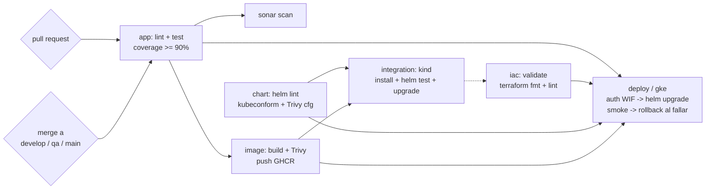
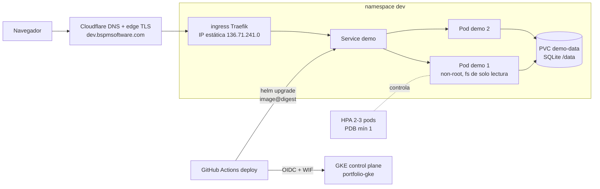

# Devsu Prueba Técnica DevOps

Prueba técnica DevOps. API Django sobre GKE, toda la plataforma como código, CI/CD sin pasos manuales.

## Resumen

Aplicación Django REST contenedorizada y desplegada en Google Kubernetes Engine, con toda la
infraestructura definida como código (Terraform, 5 stacks) y un pipeline de CI/CD en GitHub Actions
que construye, prueba, escanea, publica y despliega la aplicación sin pasos manuales.

| Capa | Elección |
| --- | --- |
| App | Django 5 + Django REST framework (Python 3.14) |
| Imagen | contenedor non-root, despliegues por digest, publicada en GHCR |
| Clúster | GKE Standard (zonal), ingress Traefik, Workload Identity en los pods |
| Nube | GCP - organización, carpeta, proyecto, VPC y clúster declarados en Terraform |
| Edge | Cloudflare DNS + terminación TLS para los hosts `dev` / `qa` / `app` |
| CI/CD | GitHub Actions - un workflow reutilizable por etapa, despliegues con gate por environment |

## URL pública

| Ambiente | URL | Cuándo despliega |
| --- | --- | --- |
| dev | **https://dev.bspmsoftware.com/api/users/** | cada merge a `develop` |
| qa | https://qa.bspmsoftware.com/api/users/ | cada merge a `qa` |
| prod | https://app.bspmsoftware.com/api/users/ | merges a `main`, requiere aprobación del environment `prod` |

El TLS termina en el edge de Cloudflare con un certificado real del dominio, así que el navegador
siempre ve una conexión confiable. El salto entre Cloudflare y el balanceador de GKE no está
cifrado hoy (el origen sirve el certificado self-signed de Traefik); cerrarlo con cert-manager es
la primera recomendación de producción de abajo.

## Estructura del repositorio

```
app/                         proyecto Django (API REST), Dockerfile incluido
.github/workflows/           pipeline.yml (orquestador) + un workflow reutilizable por etapa
docs/iac/                    logs de apply + salidas de terraform, un archivo por stack
infra/terraform/stacks/      00-bootstrap, 10-foundation, 20-platform, 30-cluster, 40-github
infra/terraform/modules/     project, network, gke, github-wif
k8s/bootstrap/               chart de una vez por namespace: PVC + RBAC desplegador (fuera de releases)
k8s/demo-chart/              chart de la aplicación (deployment, service, ingress, HPA, PDB, NetPol, hooks, tests)
scripts/                     helpers locales (smoke en kind, bootstrap de despliegue)
```

## Ejecución local
Requiere Python 3.14.
    cd app
    python -m venv .venv
    .venv\Scripts\Activate.ps1          # Windows;
    pip install --require-hashes -r requirements.txt -r requirements-dev.txt
    Copy-Item .env.example .env          # Linux/macOS: cp .env.example .env
    python manage.py migrate
    python manage.py runserver

### Docker
    docker build -t prueba-devsu ./app
    docker run --rm -p 8000:8000 prueba-devsu

## Pipeline CI/CD

Un orquestador, `.github/workflows/pipeline.yml`, invoca un workflow reutilizable por etapa
(`app-ci`, `sonar`, `image`), así cada etapa se lee y debuggea por separado mientras el run mantiene
un solo grafo de dependencias. CodeQL corre como workflow propio. Cada action está fijada a un SHA
completo de commit y cada job arranca con `GITHUB_TOKEN` solo de lectura.



| Check | Workflow | Corre en | Qué valida | Requerido |
| --- | --- | --- | --- | --- |
| `app / lint` | `app-ci.yml` | cada run | Ruff (estilo, bugs, reglas de seguridad Bandit), Hadolint | sí |
| `app / test` | `app-ci.yml` | cada run | Django checks, migraciones faltantes, pruebas unitarias, cobertura ≥ 90 % | sí |
| `sonar / scan` | `sonar.yml` | `develop` y PRs a `develop` | análisis estático y cobertura en SonarQube Cloud | no (plan free) |
| `analyze` | `codeql.yml` | cada run excepto Dependabot, y semanal | consultas de seguridad CodeQL para Python y para los workflows | no |
| `image / build` | `image.yml` | cada run | build, Trivy (falla con HIGH/CRITICAL corregible), publicación en GHCR solo en merge, attestación de provenance | sí |
| `iac / validate` | `iac.yml` | cada run | `terraform fmt -check` + `terraform validate` en cada stack, tflint | sí |
| `deploy / gke` | `deploy.yml` (reutilizable) | tras integration en merges a `develop` / `qa` / `main` | auth por Workload Identity, `helm upgrade` por digest, smoke por HTTPS, rollback automático al fallar; `prod` requiere aprobación del environment | sí |
| `uptime` | `uptime.yml` | programado cada 6 h (rama default) | sondea `PROD_URL/health/ready` y `/api/users/`; rojo hasta que `prod` tenga un despliegue real - se activa con el primer merge a `main` | no (scheduler) |
| `integration / kind` | `integration.yml` | pull requests | clúster kind efímero: instala la imagen del PR con los charts del PR, espera 2 réplicas, corre `helm test`, actualiza (backup pre-upgrade + migración), prueba de nuevo, valida el backup y el Ingress | sí |

**Identidad de imagen.** La imagen se identifica por el tree hash de git de `app/` (tag `app-<tree>`).
En un push, si esa imagen ya existe se reutiliza, así `develop → qa → main` promueve los bytes
exactos que se probaron. Los despliegues siempre usan el digest (`image@sha256:...`), nunca un tag.

### Inputs de GitHub (creados por el stack de Terraform `40-github`)

| Variable / secret | Dónde | Valor |
| --- | --- | --- |
| `GCP_PROJECT_ID` | variable de repo | `portfolio-platform-9ba0` |
| `GKE_CLUSTER` | variable de repo | `portfolio-gke` |
| `GKE_LOCATION` | variable de repo | `us-central1-c` |
| `WIF_PROVIDER` | variable de repo | ruta completa del proveedor OIDC en el pool de Workload Identity |
| `PROD_URL` | variable de repo | `https://app.bspmsoftware.com` (URL pública de `prod`) |
| `APP_HOST` | variable de environment (`dev` / `qa` / `prod`) | el host público que sirve cada ambiente |
| `DEPLOYER_SA` | variable de environment (`dev` / `qa` / `prod`) | service account que suplanta el job de despliegue |
| `DJANGO_SECRET_KEY` | secret de repo + environments | valor fijo externo; se aplica al clúster por stdin |

## Recursos de Kubernetes

Dos charts:

- **`k8s/bootstrap`** - instalado una vez por namespace y nunca por el pipeline: el PVC `demo-data`
  (`ReadWriteOnce`, `helm.sh/resource-policy: keep`) y el Role/RoleBinding `deployer`. Los datos y
  los permisos sobreviven al release de la app.
- **`k8s/demo-chart`** - la app. Cada recurso se nombra por el release (`demo`).

### Arquitectura (por ambiente, se muestra `dev`; `qa` y `prod` tienen la misma forma)



| Template | Por qué existe |
| --- | --- |
| `configmap.yaml` | settings no secretos como variables de entorno; `DJANGO_ALLOWED_HOSTS` siempre incluye `localhost` para las probes |
| `migrate-job.yaml` | hook `pre-install,pre-upgrade`: backup online de SQLite, luego `migrate`. El rollout solo empieza si tiene éxito |
| `deployment.yaml` | rolling update con `maxUnavailable: 0`; probes de startup, liveness (`/health/live`) y readiness (`/health/ready`: DB + sin migraciones pendientes); non-root, filesystem raíz de solo lectura, sin capabilities; pausa `preStop` para apagado elegante |
| `service.yaml` | ClusterIP, selecciona solo los pods web (`component: web`) |
| `ingress.yaml` | Traefik, un host DNS por ambiente (`dev` / `qa` / `app`.`bspmsoftware.com`) |
| `hpa.yaml` | 2 a 3 réplicas por CPU. Tope en 3: SQLite permite un solo escritor a la vez |
| `pdb.yaml` | al menos un pod durante interrupciones voluntarias |
| `networkpolicy.yaml` | solo Traefik y el mismo namespace alcanzan el puerto 8000 (activado en GKE) |
| `tests/smoke-test.yaml` | `helm test`: readiness, luego crear, leer y borrar un usuario a través del Service |

El Secret `DJANGO_SECRET_KEY` lo crea el pipeline a partir del secret de GitHub (valor fijo externo) y se aplica por stdin; nunca está en el repositorio ni en los values de Helm.

## Infraestructura como Código

Todo después de `gcloud auth login` es Terraform: 5 stacks aplicados en orden, cada uno con su propio
state en un bucket GCS privado y versionado, leyendo el stack anterior vía `terraform_remote_state`.

| Stack | Crea |
| --- | --- |
| `00-bootstrap` | importa el proyecto seed hecho a mano, activa sus APIs, crea el bucket de state y concede al admin los roles de folder/proyecto/políticas |
| `10-foundation` | carpeta `portfolio`, políticas de organización (sin llaves de service account, acceso uniforme de buckets, sin red por defecto), proyecto platform con presupuesto |
| `20-platform` | VPC propia, IP estática, GKE Standard zonal (Dataplane V2, Workload Identity, Shielded Nodes, SA de nodos dedicada), federación de Workload Identity con un desplegador por ambiente |
| `30-cluster` | namespaces, Traefik en la IP estática, chart bootstrap (PVC + RBAC) por ambiente |
| `40-github` | environments con políticas de rama y aprobación de prod, variables y secrets de Actions, ruleset de rama con checks requeridos |

Los módulos reutilizables viven en `infra/terraform/modules` (`project`, `network`, `gke`, `github-wif`), cada uno con su README.
Logs de apply y salidas: [`docs/iac/`](docs/iac/).

```powershell
# aplicar un stack (00-bootstrap tiene un paso único de state local, ver el runbook)
terraform -chdir=infra/terraform/stacks/<stack> init -backend-config="bucket=<state bucket>"
terraform -chdir=infra/terraform/stacks/<stack> plan -out tfplan
terraform -chdir=infra/terraform/stacks/<stack> apply tfplan
```

Se destruye en orden inverso (40 → 10). Borrar los PVCs antes de `20-platform`, o sus discos sobreviven al clúster.

## Seguridad

- **Cero credenciales de nube de larga vida**: GitHub autentica en GCP vía Workload Identity
  Federation; el pipeline canjea un token OIDC por un token GCP de vida corta. No se descargan ni
  almacenan llaves JSON. La creación de llaves de service account está deshabilitada por política
  de organización.
- **Secrets**: `DJANGO_SECRET_KEY` vive como secret de GitHub, pasa al job de despliegue y se aplica
  con `kubectl create secret` por stdin (jamás se imprime, jamás en values). En el clúster es un
  Kubernetes Secret montado por los pods.
- **Endurecimiento del contenedor**: usuario non-root, filesystem raíz de solo lectura, sin
  capabilities adicionales.
- **Actions fijados a SHA completo**; `GITHUB_TOKEN` de solo lectura en todos los jobs excepto los
  que publican la imagen o el paquete.
- **Escaneo en cada etapa**: Ruff + Bandit (lint), CodeQL (SAST), Trivy (CVEs de imagen, falla con
  HIGH/CRITICAL corregible; `.trivyignore.yaml` documenta los riesgos aceptados), escaneo de config
  de Trivy en ambos charts, quality gate de SonarQube.
- **Network policy**: solo Traefik y pods del mismo namespace alcanzan el puerto de la app;
  GKE Dataplane V2.
- **Políticas de org**: `iam.disableServiceAccountKeyCreation`, `storage.uniformBucketLevelAccess`,
  `compute.skipDefaultNetworkCreation`.
- **Protección de ramas**: ruleset con checks requeridos, sin force-push, sin eliminación; los
  despliegues de `prod` gated con aprobación de environment.

## Evidencia

- Pipeline completo verde (el run del PR)
  ([run 39700019798](https://github.com/AlexCornej0/Devsu-technical-test/actions/runs/39700019798)):
  build, lint, pruebas con cobertura, Sonar, Trivy, validación de charts, integration en kind - todo
  pasando. Los despliegues se saltan en PRs por diseño y corren en los merges.
- La app que responde en la URL pública de arriba corre en GKE sobre el digest publicado al momento
  del merge; el smoke público post-despliegue de esos runs de merge falla con 403 porque Cloudflare
  bloquea IPs de datacenter (documentado en "No hecho y por qué").
- Capturas de pantalla de los runs: los logs de Actions requieren sesión de GitHub, así que las
  capturas viajan en el zip del entregable, no en este repositorio.
- Logs de apply y de salidas de Terraform por stack: [`docs/iac/`](docs/iac/).

## Decisiones de diseño y trade-offs

- **SQLite en un PVC en lugar de Postgres**: el ejercicio entrega SQLite; mantenerlo mantiene la app
  como un único desplegable. Trade-off: un solo escritor a la vez, así que el HPA está limitado a 3
  réplicas. Los backups pasan por un hook de backup online pre-upgrade antes de cada migración.
  Documentado como el principal trade-off de producción abajo.
- **Despliegues por digest, reutilización de imagen por tree hash**: `develop → qa → main` promueve
  los bytes exactos probados; la imagen solo se reconstruye cuando `app/` cambia.
- **Cloudflare para TLS en lugar de Let's Encrypt en el clúster**: un clúster de prueba personal
  obtiene un certificado real sin lógica de renovación en el clúster; ya había un dominio en
  Cloudflare. Trade-off: el balanceador de origen también acepta HTTP plano de cualquier fuente hoy -
  restringir las IPs de origen a los rangos de Cloudflare es un pendiente de producción.
- **Ambientes como GitHub environments, no variantes de configuración por rama del workflow**: el
  workflow de despliegue es un `workflow_call`; la rama `develop` apunta al environment `dev`, la
  rama `qa` a `qa`, `main` a `prod` con aprobación requerida. Un archivo reutilizable, tres gates.
- **Despliegues rollback-first**: smoke después del rollout; al fallar, `helm rollback` a la última
  revisión superseded. El camino se ejercita en el test de integración kind (upgrade, fallo,
  rollback, re-prueba).

## Runbook de operaciones

| Tarea | Comando / acción |
| --- | --- |
| Reintentar un despliegue fallido | `gh run rerun <run-id> --failed`, o re-run desde la UI de Actions |
| Salud de la app | `curl https://dev.bspmsoftware.com/api/users/` y `/health/ready` |
| Rotar el secret de Django | actualizar el secret de GitHub, re-correr el despliegue; los pods se reinician |
| Rollback manual | `helm rollback demo <revision> -n dev` |
| Destruir el ambiente | `terraform destroy` de los stacks en orden inverso (40 → 10); borrar los PVCs antes de destruir el stack del clúster |
| Ubicación del state | `gs://<state-bucket>/portfolio/<stack>/` (por stack), versionado |

## No hecho y por qué

- **Let's Encrypt / cert-manager en el clúster**: reemplazado por TLS en el edge de Cloudflare; el
  origen todavía habla HTTP con el proxy de Cloudflare. Si el dominio sale de Cloudflare,
  cert-manager es el siguiente paso documentado.
- **Cloudflare bloquea IPs de datacenter**: el smoke del runner de GitHub recibe 403 del edge de
  Cloudflare (protección anti-bot). Opciones: una regla WAF skip para los paths de salud, o mover el
  smoke post-despliegue dentro del clúster contra el Service. Hasta entonces, el smoke público falla
  mientras la app en sí está sana (verificado desde una conexión residencial).
- **Origen abierto a fuentes que no son Cloudflare**: el balanceador de GCP todavía acepta HTTP plano
  de cualquier IP; el fix es una regla de firewall restringida a los rangos de Cloudflare
  (ítems de producción 1 y 2).
- **PostgreSQL**: fuera del alcance del ejercicio; la app se entregó con SQLite. El chart ya aísla el
  storage en un PVC, así que cambiar el backend no toca la forma del deployment.
- **Stack de monitoreo (Prometheus/Grafana)**: el chart expone métricas de pods, y el ejercicio solo
  requería escalamiento horizontal - documentado en recomendaciones de producción.

## Recomendaciones de producción

1. **Certificado en el clúster** (cert-manager con ACME HTTP-01) para que el origen hable HTTPS
   extremo a extremo y Cloudflare pueda correr en modo `Full (strict)`.
2. **Regla de firewall que restrinja el puerto 80 del balanceador a los rangos IP de Cloudflare**.
3. **PostgreSQL + secret store separado** (External Secrets Operator contra GCP Secret Manager) en
   lugar de SQLite; el tope del HPA desaparece.
4. **Monitoreo**: Prometheus + Grafana + alertas de latencia/presupuesto de error; Sentry para errores
   de app.
5. **Autoescalamiento del node pool** para que el autofuncionamiento de pods no quede limitado por la
   capacidad de nodos.
6. **Backups**: backups programados a nivel disco o basados en Litestream si se mantiene SQLite; WAL
   si se adopta Postgres.
7. **CI más endurecido**: gates de vulnerabilidades de imagen por environment para el despliegue de
   `main`, y una attestación de imagen firmada (`cosign`) verificada en admisión.

> README principal en inglés (`README.md`); esta traducción en español busca fidelidad exacta. Si
> hay discrepancia, manda el inglés.
