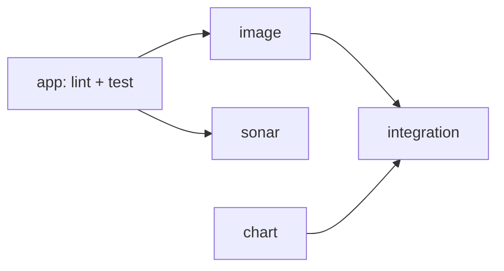

# Devsu DevOps Technical Test

## Overview
## Live URL
## Repository structure
## Run locally
Requires Python 3.14.
    cd app
    python -m venv .venv
    .venv\Scripts\Activate.ps1          # Windows;
    pip install --require-hashes -r requirements.txt -r requirements-dev.txt
    Copy-Item .env.example .env          # Linux/macOS: cp .env.example .env
    python manage.py migrate
    python manage.py test
    python manage.py runserver

Dependencies are declared in `requirements.in` / `requirements-dev.in` and locked with hashes by pip-tools:

pip-compile --generate-hashes --strip-extras -o requirements.txt requirements.in
## Environment variables
| Variable | Required | Default | Description |
| --- | --- | --- | --- |
| `DJANGO_SECRET_KEY` | yes | - | Django cryptographic key. Comes from a Kubernetes Secret in the cluster. |
| `DATABASE_NAME` | yes | - | SQLite file. Relative to `app/` locally; `/data/db.sqlite3` in containers. |
| `DJANGO_DEBUG` | no | `False` | Never `True` outside local development. |
| `DJANGO_ALLOWED_HOSTS` | no | empty | Comma-separated hosts Django will answer. Must include `localhost` (probes). |
| `DJANGO_LOG_LEVEL` | no | `INFO` | Root log level, written to stdout. |

### Docker

```powershell
docker build -t demo-api:local app
docker volume create demo-data-local
docker run --rm --env-file app/.env -e DATABASE_NAME=/data/db.sqlite3 -v demo-data-local:/data demo-api:local python manage.py migrate
docker run -d --name demo --env-file app/.env -e DATABASE_NAME=/data/db.sqlite3 -v demo-data-local:/data -p 8000:8000 demo-api:local
```
## CI/CD pipeline

An orchestrator, `.github/workflows/pipeline.yml`, calls one reusable workflow per stage (`app-ci`, `sonar`,
`image`), so each stage can be read and debugged on its own while the run keeps a single dependency graph.
CodeQL runs as its own workflow. Every action is pinned to a full commit SHA and every job starts from a
read-only `GITHUB_TOKEN`.



| Check | Workflow | Runs on | What it checks | Required |
| --- | --- | --- | --- | --- |
| `app / lint` | `app-ci.yml` | every run | Ruff (style, bugs, Bandit security rules), Hadolint | yes |
| `app / test` | `app-ci.yml` | every run | Django checks, missing migrations, unit tests, coverage ≥ 90 % | yes |
| `sonar / scan` | `sonar.yml` | `develop` and PRs to `develop` | SonarQube Cloud static analysis and coverage | no (free plan) |
| `analyze` | `codeql.yml` | every run except Dependabot, and weekly | CodeQL security queries for Python and for the workflows | no |
| `image / build` | `image.yml` | every run | Build, Trivy (fails on fixable HIGH/CRITICAL), publish to GHCR only on merge, provenance attestation | yes |

**Image identity.** The image is identified by the git tree hash of `app/` (`app-<tree>` tag). On a push, if that
image already exists it is reused, so promoting `develop → qa → main` deploys the exact bytes that were tested.
Deployments always use the digest (`image@sha256:...`), never a tag.

| `chart / validate` | `chart.yml` | every run | Both charts rendered for dev/qa/prod with and without HPA, `helm lint --strict`, kubeconform schemas, Trivy misconfiguration scan | yes |
| `integration / kind` | `integration.yml` | pull requests | Ephemeral kind cluster: installs the PR image with the PR charts, waits for 2 replicas, runs `helm test`, upgrades (pre-upgrade backup + migration), tests again, checks the backup and the Ingress | yes |
## Kubernetes resources

Two charts:

- **`k8s/bootstrap`** - installed once per namespace and never by the pipeline: the `demo-data` PVC
  (`ReadWriteOnce`, `helm.sh/resource-policy: keep`) and the `deployer` Role/RoleBinding. Data and permissions
  outlive the app release.
- **`k8s/demo-chart`** - the app. Every resource is named after the release (`demo`).

| Template | Why it exists |
| --- | --- |
| `configmap.yaml` | Non-secret settings as environment variables; `DJANGO_ALLOWED_HOSTS` always includes `localhost` for the probes |
| `migrate-job.yaml` | `pre-install,pre-upgrade` hook: SQLite online backup, then `migrate`. The rollout only starts if it succeeds |
| `deployment.yaml` | Rolling update with `maxUnavailable: 0`; startup, liveness (`/health/live`) and readiness (`/health/ready`: DB + no pending migrations) probes; non-root, read-only root filesystem, no capabilities; `preStop` pause for graceful shutdown |
| `service.yaml` | ClusterIP, selects only the web pods (`component: web`) |
| `ingress.yaml` | Traefik, one host per environment (`<env>.<ip>.nip.io`) |
| `hpa.yaml` | 2 to 3 replicas on CPU. Capped at 3: SQLite allows one writer at a time |
| `pdb.yaml` | At least one pod during voluntary disruptions |
| `networkpolicy.yaml` | Only Traefik and the same namespace can reach port 8000 (enabled on GKE) |
| `tests/smoke-test.yaml` | `helm test`: readiness, then create, read and delete a user through the Service |

The `DJANGO_SECRET_KEY` Secret is created by the pipeline from a GitHub Environment secret; it is never in the repository or in Helm values.
## Infrastructure as Code

Everything after `gcloud auth login` is Terraform: 5 stacks applied in order, each with its own state in a
private, versioned GCS bucket, reading the previous stack through `terraform_remote_state`.

| Stack | Creates |
| --- | --- |
| `00-bootstrap` | Imports the hand-made seed project, enables its APIs, creates the state bucket and grants the admin the folder/project/policy roles |
| `10-foundation` | `portfolio` folder, organization policies (no service account keys, uniform bucket access, no default network), platform project with a budget |
| `20-platform` | Custom VPC, static IP, zonal GKE Standard (Dataplane V2, Workload Identity, Shielded Nodes, dedicated node SA), Workload Identity Federation with one deployer per environment |
| `30-cluster` | Namespaces, Traefik on the static IP, the bootstrap chart (PVC + RBAC) per environment |
| `40-github` | Environments with branch policies and prod approval, Actions variables and secrets, branch ruleset with required checks |

Reusable modules live in `infra/terraform/modules` (`project`, `network`, `gke`, `github-wif`), each with its own README.
Apply and output logs: [`docs/iac/`](docs/iac/).

```powershell
# apply a stack (00-bootstrap has a one-time local-state step, see the runbook)
terraform -chdir=infra/terraform/stacks/<stack> init -backend-config="bucket=<state bucket>"
terraform -chdir=infra/terraform/stacks/<stack> plan -out tfplan
terraform -chdir=infra/terraform/stacks/<stack> apply tfplan
```

Destroy in reverse order (40 → 10). Delete the PVCs before `20-platform`, or their disks outlive the cluster.
## Security
## Evidence
## Design decisions and trade-offs
## Operations runbook
## Not done and why
## Production recommendations
