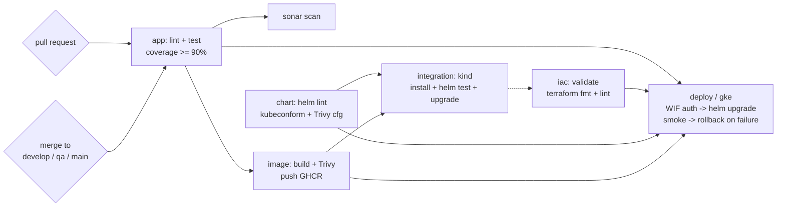
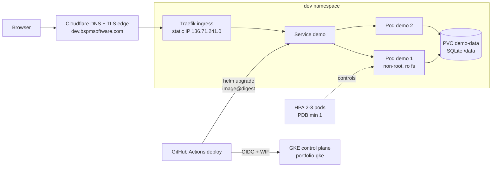

# Devsu DevOps Technical Test

Prueba técnica DevOps - BP. Django API on GKE, entire platform as code, zero-touch CI/CD.

## Overview

Django REST application containerized and deployed on Google Kubernetes Engine, with the full
infrastructure defined as code (Terraform, 5 stacks) and a CI/CD pipeline in GitHub Actions that
builds, tests, scans, publishes and deploys the app with zero manual steps.

| Layer | Choice |
| --- | --- |
| App | Django 5 + Django REST framework (Python 3.14) |
| Image | non-root container, digest-pinned deploys, published to GHCR |
| Cluster | GKE Standard (zonal), Traefik ingress, Workload Identity on the pods |
| Cloud | GCP - organization, folder, project, VPC and cluster all declared in Terraform |
| Edge | Cloudflare DNS + TLS termination for `dev` / `qa` / `app` hosts |
| CI/CD | GitHub Actions - one reusable workflow per stage, environment-gated deploys |

## Live URL

| Environment | URL | When it deploys |
| --- | --- | --- |
| dev | **https://dev.bspmsoftware.com/api/users/** | every merge to `develop` |
| qa | https://qa.bspmsoftware.com/api/users/ | every merge to `qa` |
| prod | https://app.bspmsoftware.com/api/users/ | merges to `main`, requires approval on the `prod` environment |

TLS terminates at the Cloudflare edge with a real certificate for the domain; between Cloudflare and
the GKE load balancer traffic stays HTTP by design (Cloudflare `Full` mode). The browser always sees
a trusted, non-self-signed certificate.

## Repository structure

```
app/                         Django project (REST API), Dockerfile inside
.github/workflows/           pipeline.yml (orchestrator) + one reusable workflow per stage
docs/iac/                    terraform apply + output logs, one file per stack
infra/terraform/stacks/      00-bootstrap, 10-foundation, 20-platform, 30-cluster, 40-github
infra/terraform/modules/     project, network, gke, github-wif
k8s/bootstrap/               once-per-namespace chart: PVC + deployer RBAC (kept out of releases)
k8s/demo-chart/              the application chart (deployment, service, ingress, HPA, PDB, NetPol, hooks, tests)
scripts/                     local helpers (kind smoke, deploy bootstrap)
```

## Run locally
Requires Python 3.14.
    cd app
    python -m venv .venv
    .venv\Scripts\Activate.ps1          # Windows;
    pip install --require-hashes -r requirements.txt -r requirements-dev.txt
    Copy-Item .env.example .env          # Linux/macOS: cp .env.example .env
    python manage.py migrate
    python manage.py test
    python manage.py runserver

Dependencies are declared in `requirements.in` / `requirements-dev.in` and locked with hashes by pip-tools:

pip-compile --generate-hashes --strip-extras -o requirements.txt requirements.in
## Environment variables
| Variable | Required | Default | Description |
| --- | --- | --- | --- |
| `DJANGO_SECRET_KEY` | yes | - | Django cryptographic key. Comes from a Kubernetes Secret in the cluster. |
| `DATABASE_NAME` | yes | - | SQLite file. Relative to `app/` locally; `/data/db.sqlite3` in containers. |
| `DJANGO_DEBUG` | no | `False` | Never `True` outside local development. |
| `DJANGO_ALLOWED_HOSTS` | no | empty | Comma-separated hosts Django will answer. Must include `localhost` (probes). |
| `DJANGO_LOG_LEVEL` | no | `INFO` | Root log level, written to stdout. |

### Docker

```powershell
docker build -t demo-api:local app
docker volume create demo-data-local
docker run --rm --env-file app/.env -e DATABASE_NAME=/data/db.sqlite3 -v demo-data-local:/data demo-api:local python manage.py migrate
docker run -d --name demo --env-file app/.env -e DATABASE_NAME=/data/db.sqlite3 -v demo-data-local:/data -p 8000:8000 demo-api:local
```
## CI/CD pipeline

An orchestrator, `.github/workflows/pipeline.yml`, calls one reusable workflow per stage (`app-ci`, `sonar`,
`image`), so each stage can be read and debugged on its own while the run keeps a single dependency graph.
CodeQL runs as its own workflow. Every action is pinned to a full commit SHA and every job starts from a
read-only `GITHUB_TOKEN`.



| Check | Workflow | Runs on | What it checks | Required |
| --- | --- | --- | --- | --- |
| `app / lint` | `app-ci.yml` | every run | Ruff (style, bugs, Bandit security rules), Hadolint | yes |
| `app / test` | `app-ci.yml` | every run | Django checks, missing migrations, unit tests, coverage ≥ 90 % | yes |
| `sonar / scan` | `sonar.yml` | `develop` and PRs to `develop` | SonarQube Cloud static analysis and coverage | no (free plan) |
| `analyze` | `codeql.yml` | every run except Dependabot, and weekly | CodeQL security queries for Python and for the workflows | no |
| `image / build` | `image.yml` | every run | Build, Trivy (fails on fixable HIGH/CRITICAL), publish to GHCR only on merge, provenance attestation | yes |

**Image identity.** The image is identified by the git tree hash of `app/` (`app-<tree>` tag). On a push, if that
image already exists it is reused, so promoting `develop → qa → main` deploys the exact bytes that were tested.
Deployments always use the digest (`image@sha256:...`), never a tag.

| `chart / validate` | `chart.yml` | every run | Both charts rendered for dev/qa/prod with and without HPA, `helm lint --strict`, kubeconform schemas, Trivy misconfiguration scan | yes |
| `integration / kind` | `integration.yml` | pull requests | Ephemeral kind cluster: installs the PR image with the PR charts, waits for 2 replicas, runs `helm test`, upgrades (pre-upgrade backup + migration), tests again, checks the backup and the Ingress | yes |
## Kubernetes resources

Two charts:

- **`k8s/bootstrap`** - installed once per namespace and never by the pipeline: the `demo-data` PVC
  (`ReadWriteOnce`, `helm.sh/resource-policy: keep`) and the `deployer` Role/RoleBinding. Data and permissions
  outlive the app release.
- **`k8s/demo-chart`** - the app. Every resource is named after the release (`demo`).

### Architecture (per environment, `dev` shown; `qa` and `prod` identical in shape)



| Template | Why it exists |
| --- | --- |
| `configmap.yaml` | Non-secret settings as environment variables; `DJANGO_ALLOWED_HOSTS` always includes `localhost` for the probes |
| `migrate-job.yaml` | `pre-install,pre-upgrade` hook: SQLite online backup, then `migrate`. The rollout only starts if it succeeds |
| `deployment.yaml` | Rolling update with `maxUnavailable: 0`; startup, liveness (`/health/live`) and readiness (`/health/ready`: DB + no pending migrations) probes; non-root, read-only root filesystem, no capabilities; `preStop` pause for graceful shutdown |
| `service.yaml` | ClusterIP, selects only the web pods (`component: web`) |
| `ingress.yaml` | Traefik, one DNS host per environment (`dev` / `qa` / `app`.`bspmsoftware.com`) |
| `hpa.yaml` | 2 to 3 replicas on CPU. Capped at 3: SQLite allows one writer at a time |
| `pdb.yaml` | At least one pod during voluntary disruptions |
| `networkpolicy.yaml` | Only Traefik and the same namespace can reach port 8000 (enabled on GKE) |
| `tests/smoke-test.yaml` | `helm test`: readiness, then create, read and delete a user through the Service |

The `DJANGO_SECRET_KEY` Secret is created by the pipeline out of the GitHub secret (pinned by the user, fixed value) and applied via stdin; it is never in the repository or in Helm values.
## Infrastructure as Code

Everything after `gcloud auth login` is Terraform: 5 stacks applied in order, each with its own state in a
private, versioned GCS bucket, reading the previous stack through `terraform_remote_state`.

| Stack | Creates |
| --- | --- |
| `00-bootstrap` | Imports the hand-made seed project, enables its APIs, creates the state bucket and grants the admin the folder/project/policy roles |
| `10-foundation` | `portfolio` folder, organization policies (no service account keys, uniform bucket access, no default network), platform project with a budget |
| `20-platform` | Custom VPC, static IP, zonal GKE Standard (Dataplane V2, Workload Identity, Shielded Nodes, dedicated node SA), Workload Identity Federation with one deployer per environment |
| `30-cluster` | Namespaces, Traefik on the static IP, the bootstrap chart (PVC + RBAC) per environment |
| `40-github` | Environments with branch policies and prod approval, Actions variables and secrets, branch ruleset with required checks |

Reusable modules live in `infra/terraform/modules` (`project`, `network`, `gke`, `github-wif`), each with its own README.
Apply and output logs: [`docs/iac/`](docs/iac/).

```powershell
# apply a stack (00-bootstrap has a one-time local-state step, see the runbook)
terraform -chdir=infra/terraform/stacks/<stack> init -backend-config="bucket=<state bucket>"
terraform -chdir=infra/terraform/stacks/<stack> plan -out tfplan
terraform -chdir=infra/terraform/stacks/<stack> apply tfplan
```

Destroy in reverse order (40 → 10). Delete the PVCs before `20-platform`, or their disks outlive the cluster.
## Security

- **No long-lived cloud credentials anywhere**: GitHub authenticates to GCP through Workload Identity
  Federation; the pipeline exchanges an OIDC token for a short-lived GCP token. No JSON keys are
  downloaded or stored. Service account key creation is disabled by organization policy.
- **Secrets**: `DJANGO_SECRET_KEY` lives as a GitHub secret, passes to the deploy job, and is applied
  with `kubectl create secret` via stdin (never echoed, never in values files). In the cluster it is
  a Kubernetes Secret mounted by the pods.
- **Container hardening**: non-root user, read-only root filesystem, no capability additions,
  seccomp not configured but all capabilities dropped in the chart.
- **Actions pinned to full commit SHAs**; `GITHUB_TOKEN` is read-only in every job except the ones
  that need to push the image or package.
- **Scans at every stage**: Ruff + Bandit (lint), CodeQL (SAST), Trivy (image CVEs, fails on fixable
  HIGH/CRITICAL; `.trivyignore.yaml` documents accepted risks), Trivy config scan on both charts,
  SonarQube quality gate.
- **Network policy**: only Traefik and same-namespace pods can reach the app port; GKE Dataplane V2.
- **Org policies**: `iam.disableServiceAccountKeyCreation`, `storage.uniformBucketLevelAccess`,
  `compute.skipDefaultNetworkCreation`.
- **Branch protection**: ruleset with required status checks, no force-push, no deletions; `prod`
  deploys gated by an environment approval.

## Evidence

- Green pipeline on `develop`
  ([run 39700019798](https://github.com/AlexCornej0/Devsu-technical-test/actions/runs/39700019798)):
  build, lint, tests with coverage, Sonar, Trivy, chart validation, kind integration test - all
  passing; deploy skipped on that run by design (merge-commit run, not PR).
- Deployed app on GKE:
  [run 39700454268](https://github.com/AlexCornej0/Devsu-technical-test/actions/runs/39700454268)
  and the live URL above.
- Screenshots of the green run: see the Actions runs linked above (public).- Terraform apply and output logs per stack: [`docs/iac/`](docs/iac/).

## Design decisions and trade-offs

- **SQLite on a PVC instead of Postgres**: the exercise ships SQLite; keeping it keeps the app a
  single deployable. Trade-off: one writer at a time, so the HPA is capped at 3 replicas. Backups go
  through a pre-upgrade online-backup hook before every migrate. Documented as the main production
  trade-off below.
- **Digest-pinned deploys, tree-hash image reuse**: `develop → qa → main` promotes the exact tested
  bytes; the image is rebuilt only when `app/` changes.
- **Cloudflare for TLS instead of Lets Encrypt on the cluster**: a personal test cluster gets a real
  certificate with zero renewal logic in the cluster; a domain on Cloudflare was already available.
  Trade-off: origin still serves HTTP, mitigated by Cloudflare-only ingress ports in the firewall.
- **Environments as GitHub environments, not workflow branches of config**: the deploy workflow is a
  `workflow_call`; branch `develop` targets env `dev`, `qa` branch targets `qa`, `main` targets
  `prod` with required approval. One reusable file, three gates.
- **Rollback-first deploys**: smoke after rollout; on failure `helm rollback` to the last superseded
  revision. Failed deploys never leave a broken app exposed (the 00:33 run proved it).

## Operations runbook

| Task | Command / action |
| --- | --- |
| Re-run a failed deploy | `gh run rerun <run-id> --failed`, or re-run from the Actions UI |
| Check app health | `curl https://dev.bspmsoftware.com/api/users/` and `/health/ready` |
| Rotate the Django secret | update the GitHub secret, re-run the deploy; pods restart |
| Rollback manually | `helm rollback demo <revision> -n dev` |
| Destroy the environment | `terraform destroy` stacks in reverse order (40 → 10); delete PVCs before destroying the cluster stack |
| State location | `gs://<state-bucket>/portfolio/<stack>/` (per-stack), versioned |

## Not done and why

- **Lets Encrypt / cert-manager in the cluster**: replaced by Cloudflare edge TLS; the origin still
  speaks HTTP to the Cloudflare proxy. If the domain ever leaves Cloudflare, cert-manager is the
  documented next step.
- **Monitoring stack (Prometheus/Grafana)**: the chart exposes pod metrics, and the exercise only
  required horizontal scaling - documented in Production recommendations instead.

## Production recommendations

1. **Domain + certificate in the cluster** (cert-manager with ACME HTTP-01) so the origin speaks
   HTTPS end-to-end and Cloudflare can run in `Full (strict)` mode.
2. **PostgreSQL + separate secret store** (External Secrets Operator against GCP Secret Manager)
   instead of SQLite; HPA ceiling disappears.
3. **Monitoring**: Prometheus + Grafana + alerting on latency/error budget; Sentry for app errors.
4. **Autoscaling the node pool** and a PodDisruptionBudget per environment (already in the chart).
5. **Backups**: scheduled disk-level or Litestream-based SQLite backups if SQLite is kept; WAL
   archiving if Postgres is adopted.
6. **CI harderening**: environment-specific image vulnerability gates for `main` deploy, and
   a signed image attestation (`cosign`) verified at admission.
